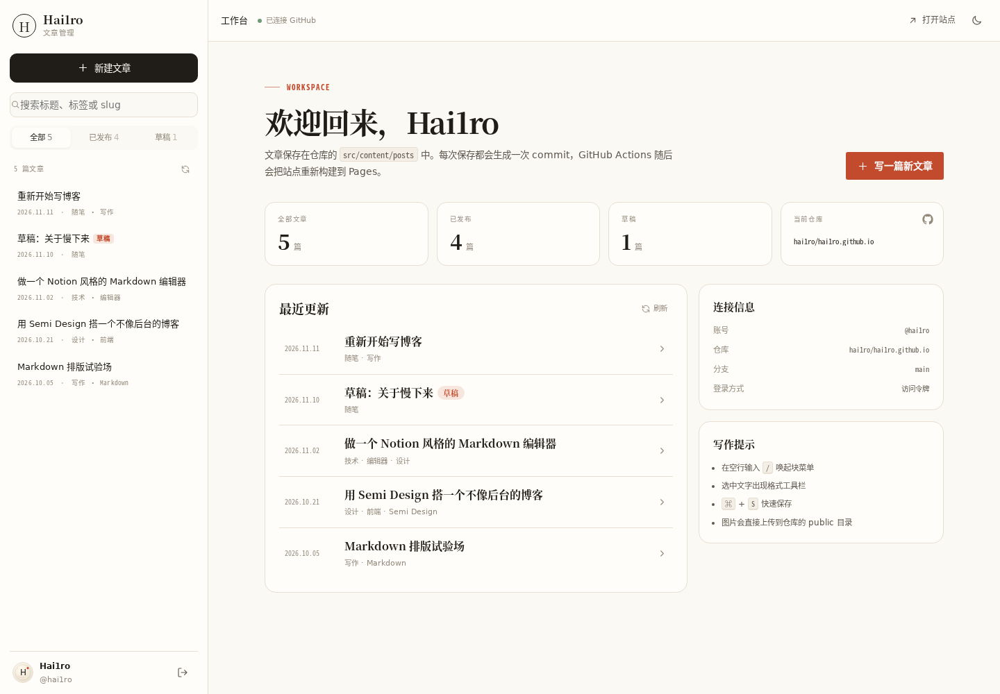
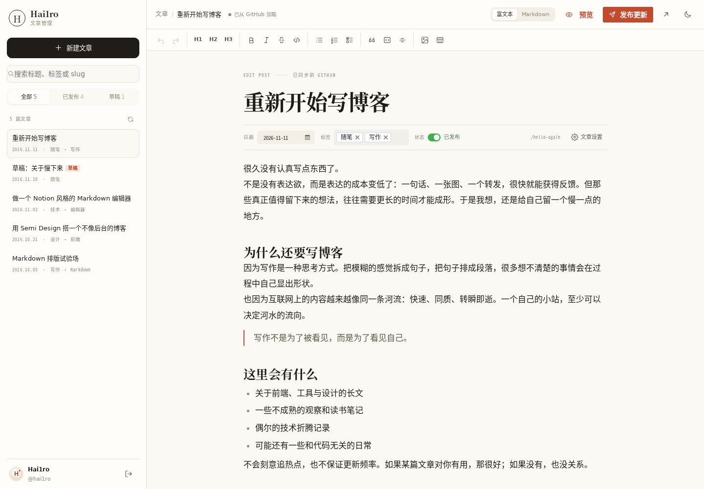

# Hai1ro · 个人博客系统

一个自己写的静态博客：**Astro 负责把 Markdown 变成页面，Semi Design 负责界面，Tiptap 提供接近 Notion 的写作体验，GitHub 仓库就是数据库。**

在 `/admin` 用 GitHub 登录后，可以新建、编辑、发布、删除仓库里的 Markdown 文件。每次保存都是一次 Git commit，GitHub Actions 会自动重新构建并部署到 GitHub Pages。


## 特性

- **静态优先**：文章在构建时由 Astro 渲染成 HTML，无运行时数据库，加载快、易备份。
- **Notion 风格编辑器**：`/` 唤起块菜单、选中文字弹出格式工具栏、块拖拽、待办列表、表格、代码块、图片粘贴上传。
- **GitHub 原生**：文章就是仓库里的 `src/content/posts/*.md`，编辑通过 GitHub Contents API 提交，天然有版本历史。
- **双登录方式**：默认 GitHub OAuth；也支持 Personal Access Token（本地开发 / 未部署 Worker 时使用）。
- **Semi Design**：后台完全使用 Semi UI 组件；博客前端沿用 Semi 的设计 token，并重做为纸张 + 朱砂的个人视觉。
- **深色模式**：博客与后台共享主题，切换后持久化，无闪烁。
- **完整内容能力**：frontmatter、草稿、标签、封面、摘要、RSS、sitemap、阅读时间、文章目录、SEO / Open Graph。
- **图片上传**：图片以内容哈希命名上传到 `public/images/uploads/YYYY/MM/`，自动去重，保存为 Markdown 图片引用。

## 技术栈

| 层 | 选择 |
| --- | --- |
| 框架 | Astro 5（静态输出） |
| 交互 | React 18（仅后台） |
| UI | Semi Design 2.x |
| 编辑器 | Tiptap 3 + ProseMirror + lowlight |
| Markdown | marked（md → html）+ Turndown（html → md）+ YAML |
| 鉴权 | GitHub OAuth（Cloudflare Worker 代理）+ PAT |
| 部署 | GitHub Pages + GitHub Actions |

## 目录结构

```text
.
├── src/
│   ├── admin/                 # 管理后台（React，浏览器端动态加载）
│   │   ├── auth/              # OAuth 弹窗、登录态
│   │   ├── components/        # 登录、工作台、编辑器、属性面板
│   │   ├── data/              # GitHub 文章仓库
│   │   ├── editor/            # Tiptap 扩展、slash 菜单、气泡菜单
│   │   ├── github/            # GitHub Contents API 客户端
│   │   └── styles/admin.css
│   ├── components/            # 博客组件
│   ├── config/                # 站点信息、仓库配置
│   ├── content/posts/         # ← 文章源文件（后台读写这里）
│   ├── layouts/
│   ├── lib/                   # frontmatter、Markdown、slug、日期
│   ├── pages/                 # 首页、文章、归档、关于、/admin、RSS
│   ├── scripts/               # 主题、归档筛选、代码复制
│   └── styles/
├── worker/                    # Cloudflare Worker OAuth 代理
├── public/
│   ├── images/                # 封面与上传图片
│   └── admin.html             # /admin 的兜底跳转
├── tests/                     # Vitest：Markdown 往返、Worker 安全
└── .github/workflows/         # CI 与 GitHub Pages 部署
```

## 快速开始

### 环境要求

- Node.js **20.3+**（推荐 22）
- pnpm **12**（`packageManager` 已固定；使用 pnpm 10+ 时如遇 build script 提示，运行 `pnpm approve-builds`）

```bash
pnpm install
cp .env.example .env
pnpm dev
```

打开：

- 博客：<http://localhost:4321>
- 后台：<http://localhost:4321/admin>

本地不配置 OAuth 也可以使用：在后台点「或使用 Personal Access Token」，填入一个有仓库写权限的 GitHub Token 即可。

### 常用命令

```bash
pnpm dev        # 开发
pnpm build      # 生产构建（输出 dist/）
pnpm preview    # 预览构建结果
pnpm check      # Astro + TypeScript 类型检查
pnpm test       # Vitest（含 OAuth Worker 测试）
pnpm sync       # 生成 Astro 内容类型
```

## 内容模型

文章文件位于 `src/content/posts/*.md`，文件名就是 URL slug：

```text
src/content/posts/hello-again.md  →  /posts/hello-again/
```

Frontmatter：

```yaml
---
title: 文章的标题
description: 列表和 SEO 使用的摘要
date: 2026-11-11
updated: 2026-11-12 # 可选
tags:
  - 随笔
  - 写作
cover: /images/covers/hello.svg # 可选
coverAlt: 封面替代文字 # 可选
draft: false # 草稿不会进入生产构建
featured: false # 是否优先展示在首页
---
```

- **草稿**：`draft: true` 的文件在 `pnpm dev` 中可见（带「草稿」标记），`pnpm build` / RSS / sitemap 中会被排除。
- **slug**：后台创建文章后不可修改，避免旧链接失效。
- **自定义字段**：后台会保留 frontmatter 中不认识的字段，保存时原样写回。
- **图片**：后台把图片写入 `public/images/uploads/`，Markdown 中使用 `/images/uploads/...` 路径。

## 管理后台



### 登录

1. **GitHub OAuth（推荐）**：需要先按下一节部署 Worker。
2. **Personal Access Token**：无需 Worker，适合本地或临时使用。
   - Classic Token：勾选 `repo`；
   - Fine-grained Token：对目标仓库授予 `Contents: Read and write`。

令牌只保存在当前浏览器（默认 sessionStorage，勾选「保持登录」后使用 localStorage），不会发送给 GitHub 以外的服务器。退出登录会清除令牌。

### 写作体验



- 输入 `/` 打开块菜单：标题、列表、待办、引用、代码块、分割线、表格、图片。
- 选中文字出现气泡工具栏：加粗、斜体、下划线、删除线、行内代码、链接。
- 块左侧有拖拽手柄，可以调整顺序。
- 粘贴或拖入图片会自动上传到仓库。
- 「Markdown」模式直接编辑正文源文件，适合检查实际写入的内容。
- 「文章设置」里可以修改摘要、slug（仅新建时）、封面、推荐状态，或删除文章。
- 保存冲突（文件在别处被改过）会提示 SHA 不匹配，刷新后重试即可。
- `⌘/Ctrl + S` 保存；`⌘/Ctrl + B`、`⌘/Ctrl + I` 等是 Tiptap 默认快捷键。

保存行为：

- 每次保存通过 GitHub Contents API 提交一个 commit，提交信息形如 `post: 更新《标题》`；
- 草稿 / 发布由 frontmatter 的 `draft` 决定；
- 提交后 GitHub Actions 构建通常需要 1–2 分钟，后台顶部的「已保存」表示已经提交到 GitHub（或已从仓库加载），不代表 Pages 构建完成。

## OAuth 部署

GitHub 的 `code → access_token` 交换必须携带 `client_secret`，不能放在静态站点里。因此项目内置了一个无依赖的 Cloudflare Worker 作为代理，只需要部署一次。

### 1. 创建 GitHub OAuth App

打开 <https://github.com/settings/applications/new>：

- **Application name**：随意，例如 `Hai1ro Blog Admin`
- **Homepage URL**：`https://hai1ro.github.io`
- **Authorization callback URL**：先填一个占位地址，等 Worker 部署后再回来改成：

```text
https://<你的-worker-子域>.workers.dev/callback
```

创建后记下 **Client ID**，并生成 **Client Secret**。

### 2. 部署 Worker

需要 Cloudflare 账号（免费计划即可）：

```bash
cd worker
npx wrangler login
```

编辑 `worker/wrangler.toml`：

```toml
[vars]
GITHUB_CLIENT_ID = "你的 Client ID"
GITHUB_SCOPE = "repo read:user"
ALLOWED_ORIGINS = "https://hai1ro.github.io"
```

保存 Client Secret（不会写入配置文件）：

```bash
npx wrangler secret put GITHUB_CLIENT_SECRET
npx wrangler deploy
```

部署完成后：

1. 把 Worker 地址填回 OAuth App 的 **Authorization callback URL**（必须是 `<worker>/callback`，完全一致）；
2. 访问 `<worker>/health`，应看到 `{"ok":true,"configured":true}`；
3. 在 `worker/wrangler.toml` 的 `ALLOWED_ORIGINS` 中可以配置多个来源（逗号分隔，不带结尾斜杠）。本地调试 OAuth 时临时加入 `http://localhost:4321`，生产环境建议只保留正式域名。

Worker 的安全设计：

- 只允许 `ALLOWED_ORIGINS` 中的来源发起登录；
- `state` 使用 `client_secret` 做 HMAC 签名，10 分钟过期，防篡改；
- token 只通过 `postMessage` 发给白名单 origin，不出现在 URL 或日志中；
- 回调页使用严格 CSP、`no-store`、`no-referrer`。

### 3. 配置前端

本地 `.env`：

```bash
PUBLIC_OAUTH_PROXY_URL=https://<你的-worker-子域>.workers.dev
```

GitHub 仓库 **Settings → Secrets and variables → Actions → Variables** 添加同名变量，下一次构建生效：

```text
PUBLIC_OAUTH_PROXY_URL = https://<你的-worker-子域>.workers.dev
```

然后重新打开 `/admin`，点击「使用 GitHub 登录」即可。

> 如果 OAuth 还未配置，后台仍可使用 PAT 登录；部署步骤也会在登录页的弹窗中提示。

## 部署到 GitHub Pages

1. 仓库 **Settings → Pages → Build and deployment → Source** 选择 **GitHub Actions**。
2. 推送到 `main`，或手动运行 **Deploy to GitHub Pages** workflow。
3. 在 **Settings → Secrets and variables → Actions → Variables** 中按需配置：

| 变量 | 默认值 | 说明 |
| --- | --- | --- |
| `PUBLIC_SITE_URL` | `https://hai1ro.github.io` | 站点地址，用于 canonical / sitemap / OG |
| `PUBLIC_GITHUB_OWNER` | `hai1ro` | 仓库所有者 |
| `PUBLIC_GITHUB_REPO` | `hai1ro.github.io` | 仓库名 |
| `PUBLIC_GITHUB_BRANCH` | `main` | 读写分支 |
| `PUBLIC_OAUTH_PROXY_URL` | 空 | Worker 地址；为空时只能 PAT 登录 |

构建流程（`.github/workflows/deploy.yml`）：

```text
install → astro sync → astro check → vitest → astro build → upload-pages-artifact → deploy-pages
```

### 自定义域名

1. 在仓库 Pages 设置中绑定域名；
2. 更新 `PUBLIC_SITE_URL`；
3. 更新 `src/config/site.ts` 中的链接；
4. 更新 OAuth App 的 Homepage URL 和 Worker 的 `ALLOWED_ORIGINS`；
5. 如果 Worker 使用自定义域名，更新 `OAUTH_CALLBACK_URL` 与 OAuth App 回调地址。

### 部署到子路径

当前配置假设站点在域名根目录（用户站点 `hai1ro.github.io`）。如果部署在 `https://user.github.io/blog/`，需要：

- 在 `astro.config.mjs` 添加 `base: '/blog'`；
- 调整图片、RSS、链接路径；
- 更新 Worker 的 `ALLOWED_ORIGINS` 为带路径的 origin（origin 不含路径）；
- `public/admin.html` 与后台的 `/admin/` 路径也需同步调整。

## 主题定制

- 站点标题、作者、导航、社交链接：`src/config/site.ts`
- 仓库、分支、OAuth 地址：`src/config/blog.ts`（通过 `PUBLIC_*` 环境变量覆盖）
- 颜色、字体、间距：`src/styles/tokens.css`
- 博客排版：`src/styles/site.css`
- 后台与编辑器：`src/admin/styles/admin.css`

博客使用 Semi 的 CSS 变量作为底座（`--semi-color-primary` 等），因此后台的 Semi 组件会与博客主色保持一致；公共页面只加载自己的样式，避免引入整套组件库。

## 常见问题

**Q：GitHub 登录提示 `redirect_uri_mismatch`？**

OAuth App 的 callback URL 必须与 Worker 实际调用地址完全一致，包括协议、域名、路径，通常就是 `<worker>/callback`。

**Q：提示「没有仓库写权限」？**

OAuth scope 默认是 `repo read:user`；PAT 需要 `repo`（Classic）或 `Contents: Read and write`（Fine-grained）。同时确认登录账号对 `PUBLIC_GITHUB_OWNER/PUBLIC_GITHUB_REPO` 有 push 权限。

**Q：保存时提示「文件已在其他地方被修改（SHA 不匹配）」？**

说明文章在另一个窗口/设备上被改过。刷新后台、重新打开文章后再保存。

**Q：保存成功了，但站点没更新？**

后台保存的是 GitHub commit；需要等 GitHub Actions 构建完成。打开仓库的 Actions 页面查看构建状态。

**Q：`/admin` 直接访问 404？**

GitHub Pages 对目录会做 `/admin/` 重定向；仓库还提供了 `public/admin.html` 作为兜底。确认 Pages Source 为 **GitHub Actions**，并且构建成功。

**Q：图片上传失败？**

支持 PNG / JPEG / WebP / GIF / AVIF，单张不超过 4 MB；出于安全原因不允许 SVG。图片路径为内容哈希，同名图片会自动复用。

**Q：本地 `pnpm install` 提示 build script 被忽略？**

`pnpm-workspace.yaml` 中已经通过 `allowBuilds` 允许 `esbuild` 与 `sharp`。如果使用较老的 pnpm，可运行 `pnpm approve-builds` 手动允许。

**Q：后台为什么不在首屏 HTML 里？**

`/admin` 使用浏览器端动态加载（`AdminMount`），避免把 Semi UI / Tiptap 的体积带进静态页面；登录后编辑器会从 GitHub 拉取文章。

## 安全说明

- 前端只包含 `PUBLIC_*` 变量，**不要**把 `client_secret` 写进 `.env` 或仓库。
- OAuth Worker 的 secret 使用 `wrangler secret` 保存，部署时不会进入 Git。
- token 存在浏览器 storage 中，本质上仍是对抗 XSS 的最后一道防线；不要在后台页面引入不可信的第三方脚本。
- 图片上传禁止 SVG，避免同源脚本注入。
- 删除文章是不可撤销的 Git 删除操作，后台会二次确认。

## 说明

文章与图片版权归作者所有。代码部分可自由参考、修改，用于自己的博客。
